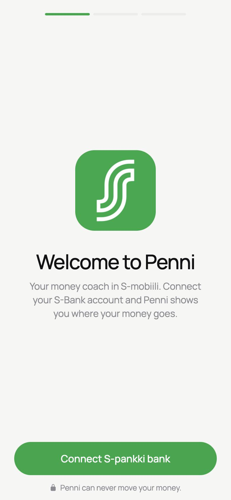
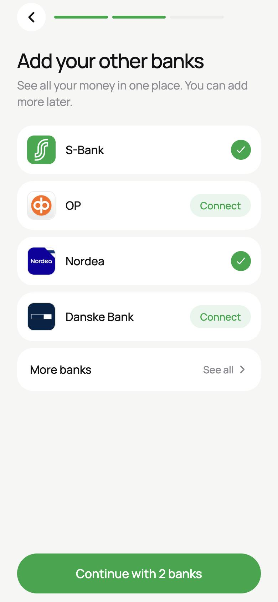
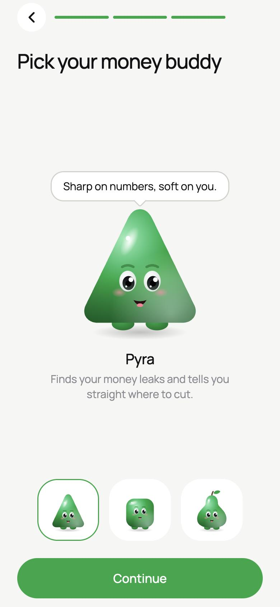
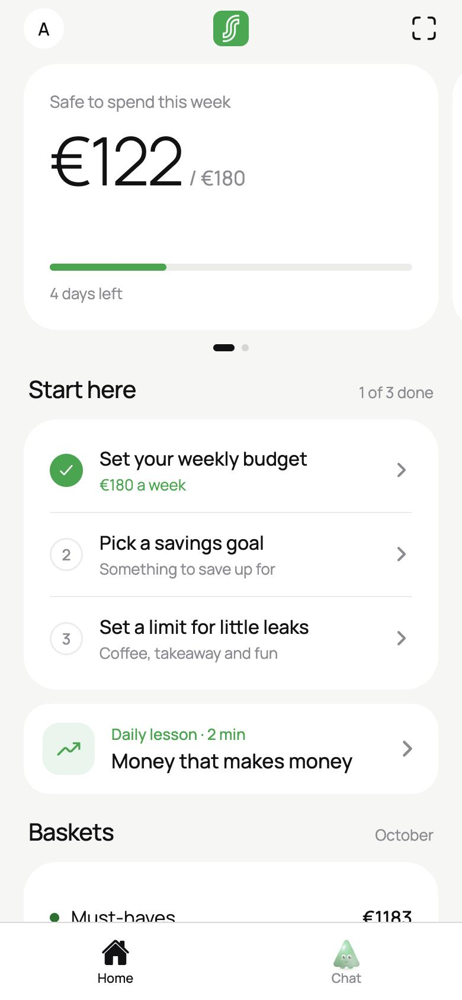
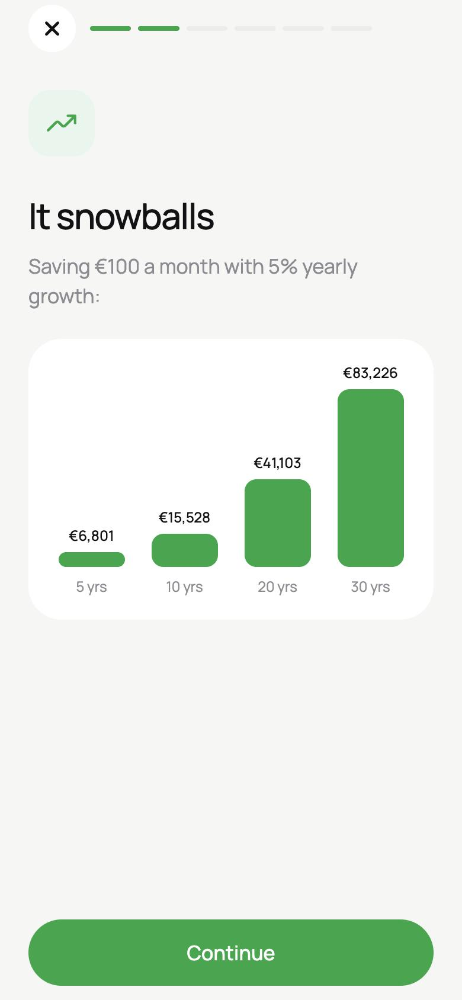
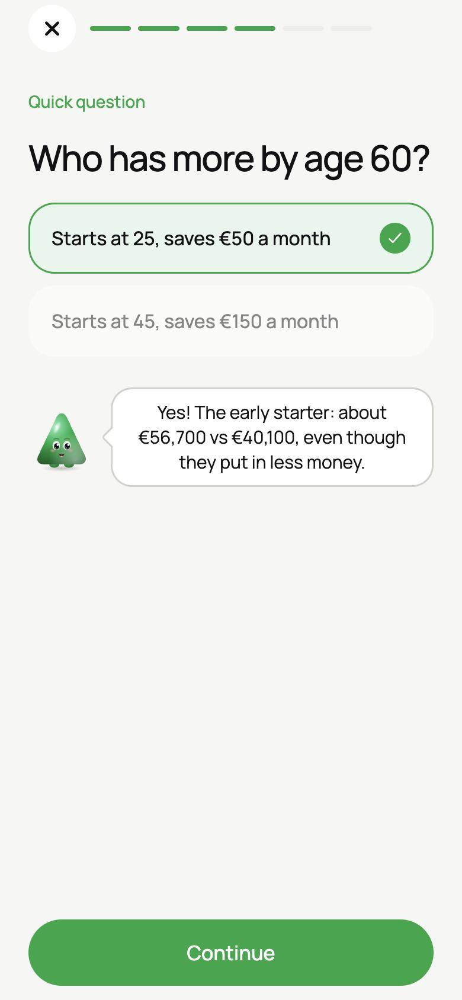
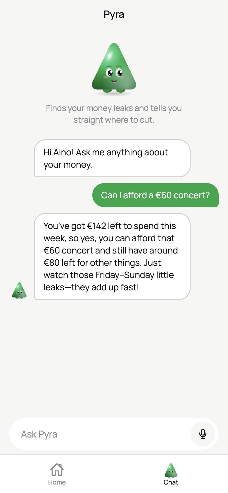

# Penni

**An AI money coach for young adults, built to live inside S-mobiili.**
Junction 2026 · S-Bank "AI Financial Coach" challenge.

<p>
  
  
  
  
</p>
<p>
  
  
  
  
</p>

## What it does

- **Three baskets:** spending sorted into Must-haves, Surprises and Little leaks.
- **Your own money buddy:** pick a bot, then ask it anything by text or voice. Answers use your real numbers.
- **Start here:** set a weekly budget, a savings goal and a little-leaks limit. The app and the AI both use them.
- **Daily lesson:** a two-minute lesson with a chart and a quiz, a new one every day.

## Run it

```bash
npm install
cp .env.example .env      # add your OpenAI API key
npm run server            # AI server on :8787 (keeps the key off the phone)
npx expo start            # scan the QR code with Expo Go
```

Built with Expo (React Native) and OpenAI (`gpt-4.1-mini` for chat, `gpt-4o-mini-transcribe` for voice).
